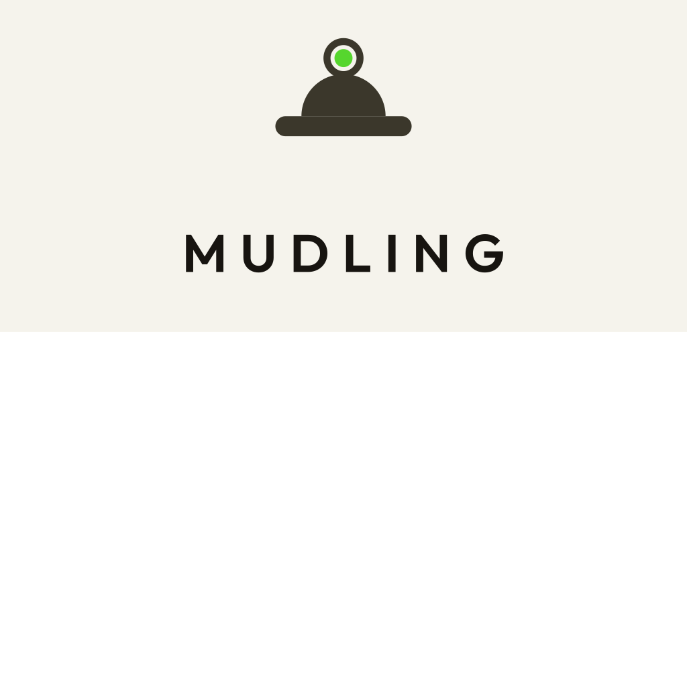

<p align="center">
  <picture>
    <source media="(prefers-color-scheme: dark)" srcset="assets/brand/mudling-primary-dark.png">
    
  </picture>
</p>

**MUDling** is a touch-first, open-source MUD client. A mudling is a small
creature of living mud — and MUD is where it lives: exits become a D-pad,
the things in the room become tappable, and commands compose by touch
instead of typing. Protocol-aware (GMCP/MXP) and accessibility-first.

> Early days. The headless core is here: the connection layer (telnet, GMCP,
> MCCP2), line pipeline, plugin host with Luau hooks, versioned stores, map,
> persistence and completion, with the Avatar game plugin on top. The desktop
> shell is still the Phase 0 spike and doesn't use most of the core yet: a gpui
> window with a virtualized chat, a command input with IME, and a first
> accessibility pass. See [docs/phase-0-spike.md](docs/phase-0-spike.md) for
> what the spike proved.

## Building

MUDling is a Cargo workspace:

| Path | What it is |
|---|---|
| `crates/mudling-core` | Everything except drawing: connection, line pipeline, plugins, stores, map, persistence, completion, scrollback |
| `crates/mudling-desktop` | The desktop shell, drawn with [gpui](https://gpui.rs) |
| `crates/mudling-bench` | The headless benchmarks against the performance budgets |
| `crates/mudling-ffi` | UniFFI bindings for the iOS app: store subscriptions and diffs (commands only echo for now) |
| `crates/mudling-cli` | The `mudling` command line (a stub for now) |
| `plugins/avatar/` | The first game plugin, in TOML and Luau |
| `apple/` | The iOS app, to come |

```sh
cargo build --release
cargo test
cargo run --release -p mudling-bench                 # the core's budgets
cargo run --release -p mudling-desktop -- --synthetic # the chat, with made-up lines
```

On Debian or Ubuntu, `scripts/install-linux-deps.sh` installs the libraries
gpui needs.

Release builds carry line-table debug info, so daily builds are release
builds that still give useful backtraces.

**gpui is pinned** to `gpui-pre 0.3.10`, an exact published snapshot of Zed's
`main` (zed@08cbb88). The crates.io `gpui` release (0.2.2) predates gpui's
AccessKit support, which MUDling needs for screen readers. Upgrades are
deliberate; [docs/phase-0-spike.md](docs/phase-0-spike.md#why-this-gpui)
explains the choice.

---

*A [Vyttle](https://vyttle.com) project.*
