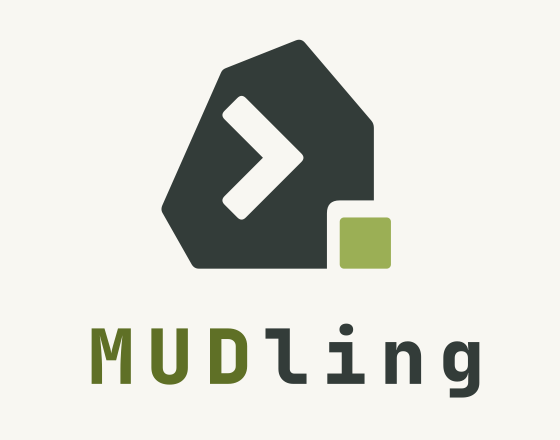

<p align="center">
  <picture>
    <source media="(prefers-color-scheme: dark)" srcset="assets/brand/mudling-primary-dark-wide.png">
    
  </picture>
</p>

**MUDling** is an open-source MUD client for macOS, Windows and Linux. A
mudling is a small creature of living mud, and MUD is where it lives.

- **Protocol-aware.** It speaks telnet with GMCP and MCCP2, so the game can
  tell MUDling about your room, your character and your map.
- **Panels.** A map, and Room, Character, Gear, Skills and Notes panels, with
  a HUD for your vitals and your opponent.
- **Yours to shape.** Triggers, aliases and a hotbar of commands.
- **Plugins.** Game plugins in TOML and Luau, and a plugin directory to find
  them in.
- **Your data, your repository.** MUDling syncs your servers, settings and
  map to a Git repository you own, and keeps saved passwords in an encrypted
  vault.
- **Keyboard and screen readers.** Every control has a name and a key.
  [docs/accessibility.md](docs/accessibility.md) is the audit.

MUDling is on the desktop today. An iPad and iPhone app is planned, not built.

## Install

Download a build from the
[releases page](https://github.com/Vyttle-LLC/mudling/releases), or install
the latest from a terminal. Replace `<version>` with the release's number,
such as `0.1.0`.

| Your computer | Download | Or install from a terminal |
|---|---|---|
| macOS, Apple Silicon | `MUDling-<version>-macos-arm64.zip` | `install.sh` |
| macOS, Intel | `MUDling-<version>-macos-x86_64.zip` | `install.sh` |
| Windows, x64 or arm64 | `MUDling-<version>-windows-<arch>-setup.exe` | `install.ps1` |
| Linux, x64 or arm64 | `MUDling-<version>-linux-<arch>.AppImage` | `install.sh` |

Each release also has `MUDling-<version>-windows-<arch>.zip` (`MUDling.exe`
alone, to run from any folder) and `MUDling-<version>-linux-<arch>.tar.gz`
(the binary, its desktop entry and icon). `<arch>` is `x64` or `arm64`.

### macOS

Unzip the download and drag `MUDling.app` to Applications. Or run this, which
puts `MUDling.app` in `/Applications` and opens it:

```sh
curl -fsSL https://raw.githubusercontent.com/Vyttle-LLC/mudling/main/scripts/install.sh | bash
```

For a particular release, add `-s -- v1.2.3` after `bash`. To install
somewhere you can write without `sudo`, set `MUDLING_INSTALL_DIR` to a folder
that exists:

```sh
curl -fsSL https://raw.githubusercontent.com/Vyttle-LLC/mudling/main/scripts/install.sh | MUDLING_INSTALL_DIR=~/Applications bash
```

**First launch.** The app is signed with Vyttle's Developer ID and notarized
by Apple, so Gatekeeper accepts it. macOS may still ask you once to confirm
that you want to open an app from the internet. The script checks the
signature, and that Vyttle's team signed it, before it installs anything. If
MUDling is running, the script quits it first.

### Windows

Double-click the `-setup.exe`, or run this in PowerShell. Both install for you
alone, without admin rights, with a Start menu entry and an uninstaller. The
app goes in `%LOCALAPPDATA%\Programs\MUDling`.

```powershell
irm https://raw.githubusercontent.com/Vyttle-LLC/mudling/main/scripts/install.ps1 | iex
```

For a particular release:

```powershell
& ([scriptblock]::Create((irm https://raw.githubusercontent.com/Vyttle-LLC/mudling/main/scripts/install.ps1))) v1.2.3
```

**First launch.** Windows builds are unsigned for now. A downloaded `-setup.exe`
or `MUDling.exe` opens a blue **Windows protected your PC** box, because
Microsoft Defender SmartScreen doesn't know the publisher. Click **More info**,
then **Run anyway**. Edge may also say the file isn't commonly downloaded; keep
it. `install.ps1` avoids both. Once the builds are signed, the warning will
name Vyttle LLC and fade as the signature earns reputation.

### Linux

Download the AppImage, make it executable and run it. Or run this, which puts
the AppImage at `~/.local/bin/MUDling.AppImage` and adds a menu entry:

```sh
curl -fsSL https://raw.githubusercontent.com/Vyttle-LLC/mudling/main/scripts/install.sh | bash
```

For a particular release, add `-s -- v1.2.3` after `bash`.

**First launch.** The builds come from Ubuntu 22.04, so they need glibc 2.35 or
newer, and the desktop libraries MUDling draws with: X11 or Wayland, xkbcommon,
fontconfig, freetype and ALSA. Most desktops have them. On Debian or Ubuntu,
`scripts/install-linux-deps.sh` installs them.

### Updates

Running the install command again upgrades MUDling in place.

MUDling also updates itself. At launch and then daily it checks GitHub
Releases. When a newer release is ready, Settings says so. The update goes in
when you quit, or when you choose **Restart to update**. Everything is saved
first. Each download is checked against the SHA-256 digest GitHub publishes for
it, and a failed update leaves your copy as it was.

Turn it off under Settings → Data & sync → Updates, with **Check for updates**.
**Check now** looks at once.

A copy updates only if MUDling can replace it: the folder holding it must be
writable, and a copy built from source never updates. On Linux, only the
AppImage updates; the `.tar.gz` doesn't. Settings says why a copy can't update.
[docs/updates.md](docs/updates.md) has the details.

### Uninstall

Uninstalling never touches your data folder. Your servers, settings, logs and
vault stay where they are, so a later install picks them up. Delete the folder
too if you want them gone.

| OS | Remove the app | Data folder |
|---|---|---|
| macOS | Quit MUDling and move `MUDling.app` to the Trash | `~/Library/Application Support/com.Vyttle.MUDling` |
| Windows | Settings → Apps → Installed apps → MUDling → Uninstall. For the `.zip`, delete its folder | `%APPDATA%\Vyttle\MUDling\data` |
| Linux | Delete `~/.local/bin/MUDling.AppImage`, `~/.local/share/applications/com.vyttle.mudling.desktop` and `~/.local/share/icons/com.vyttle.mudling.png` | `~/.local/share/mudling` |

On Linux, if `XDG_DATA_HOME` is set, use it in place of `~/.local/share`.
Updates keep a download in the OS's cache folder, which you can delete too.

[docs/releasing.md](docs/releasing.md) says how a release is made.

## Building

MUDling is a Cargo workspace:

| Path | What it is |
|---|---|
| `crates/mudling-core` | Everything except drawing: connection, line pipeline, plugins, stores, map, persistence, completion, scrollback |
| `crates/mudling-desktop` | The desktop shell, drawn with [gpui](https://gpui.rs) |
| `crates/mudling-bench` | The headless benchmarks against the performance budgets |
| `crates/mudling-ffi` | UniFFI bindings for the iOS app: store subscriptions and diffs (commands only echo for now) |
| `crates/mudling-cli` | The `mudling` command line, for plugin authors: `mudling plugin new` and `mudling plugin test` |
| `plugins/avatar/` | The first game plugin, in TOML and Luau |
| `plugins/aardwolf/` | The Aardwolf game plugin: TOML alone, over Aardwolf's GMCP |
| `docs/plugins/` | The plugin [API reference](docs/plugins/reference.md) and [cookbook](docs/plugins/cookbook.md) |
| `apple/` | The iOS app, to come |

```sh
cargo build --release
cargo test
cargo run --release -p mudling-bench                 # the core's budgets (--check exits 1 on a miss)
cargo run --release -p mudling-desktop -- --synthetic # the chat, with made-up lines
```

On Debian or Ubuntu, `scripts/install-linux-deps.sh` installs the libraries
gpui needs.

Release builds carry line-table debug info, so daily builds are release
builds that still give useful backtraces.

**Benchmarks.** `mudling-bench --check` holds the core to PRD §6's numbers. Run
it locally, on a quiet machine, before each phase's pull request. A pull
request's CI checks correctness only. The benchmark, the comparison with the
last measured build, and the timing tests run daily on `main`: GitHub's shared
runners read up to 4× over the budgets and vary 2× from run to run, so only a
comparison between two builds on one machine is gated. See [docs/ci.md](docs/ci.md).

**gpui is pinned** to `gpui-pre 0.3.10`, an exact published snapshot of Zed's
`main` (zed@08cbb88). The crates.io `gpui` release (0.2.2) predates gpui's
AccessKit support, which MUDling needs for screen readers. Upgrades are
deliberate; [docs/phase-0-spike.md](docs/phase-0-spike.md#why-this-gpui)
explains the choice.

## Docs

- [docs/plugins/](docs/plugins/): the plugin [API reference](docs/plugins/reference.md) and [cookbook](docs/plugins/cookbook.md)
- [docs/accessibility.md](docs/accessibility.md): the audit of every control, and `--ax-check`
- [docs/ci.md](docs/ci.md): what CI checks on a pull request, and what runs daily
- [docs/releasing.md](docs/releasing.md): how a release is made
- [docs/updates.md](docs/updates.md): how an installed MUDling updates itself
- [docs/phase-0-spike.md](docs/phase-0-spike.md): the spike MUDling grew from

---

*A [Vyttle](https://vyttle.com) project.*
